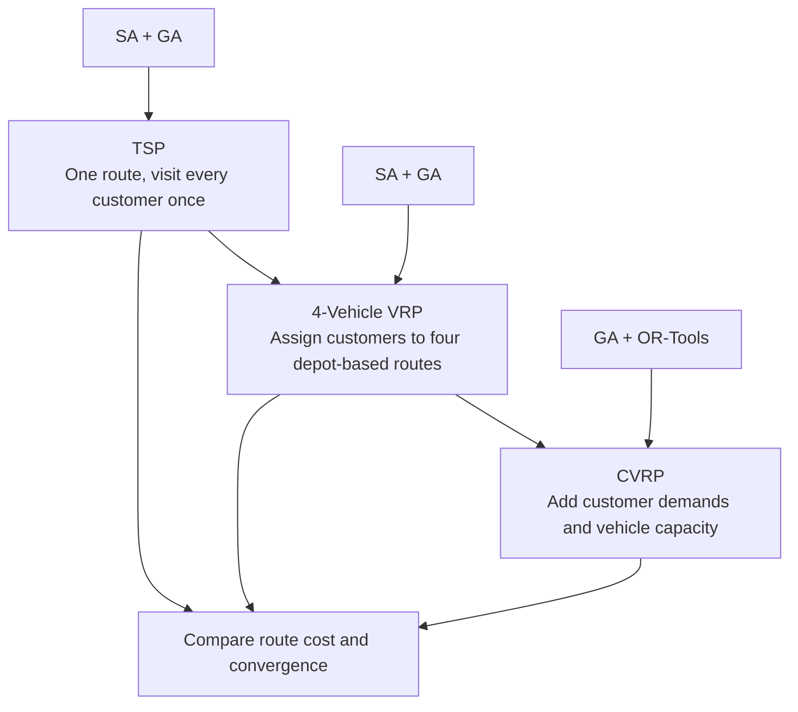

# Optimization for Vehicle Routing Problems: From Basic to Capacitated Models

A comparative study of metaheuristic and industry-standard optimization methods for progressively more constrained vehicle-routing problems. The project starts with the **Traveling Salesman Problem (TSP)**, extends it to a **four-vehicle Vehicle Routing Problem (VRP)**, and finally introduces vehicle-capacity constraints to formulate a **Capacitated Vehicle Routing Problem (CVRP)**.

The implementations compare **Simulated Annealing (SA)** and **Genetic Algorithms (GA)** with **Google OR-Tools** on a shared 17-node distance matrix.

## Project at a Glance

| Item | Description |
|---|---|
| Problem family | TSP → 4-vehicle VRP → CVRP |
| Nodes | 17 total: 1 depot + 16 customers |
| Fleet in VRP/CVRP | 4 vehicles |
| Metaheuristics | Simulated Annealing, Genetic Algorithm |
| Benchmark solver | Google OR-Tools |
| Main objective | Minimize total travel distance |
| CVRP capacity | 15 per vehicle |
| Implementation | Python, NumPy, Matplotlib, OR-Tools |
| Research report | `Project Report.pdf` |

## Problem Progression



### 1. Traveling Salesman Problem (TSP)

- One depot (node `0`) and 16 customer nodes.
- Find a single tour that visits every customer exactly once and returns to the depot.
- Objective: minimize the sum of edge costs in the tour.
- Methods: Simulated Annealing, Genetic Algorithm, and Google OR-Tools.

### 2. Four-Vehicle Routing Problem (VRP)

- Extend the single-tour problem to four vehicles.
- Every customer must be assigned to exactly one vehicle.
- Each vehicle starts and returns to the depot.
- Objective: minimize the sum of the distances traveled by all vehicles.
- Methods: Simulated Annealing, Genetic Algorithm, and Google OR-Tools.

### 3. Capacitated Vehicle Routing Problem (CVRP)

- Add a demand value \(q_i\) for each customer and a common vehicle capacity \(Q=15\).
- Four vehicles are available.
- Every customer must be served once, and the total demand assigned to each vehicle must not exceed its capacity.
- Methods in the supplied notebook: Genetic Algorithm and Google OR-Tools.

The notebook uses a fixed 17 × 17 symmetric distance matrix. The CVRP demand vector is:

```python
[0, 1, 1, 2, 4, 2, 4, 8, 8, 1, 2, 1, 2, 4, 4, 8, 8]
```

The depot has zero demand. Total customer demand is 60, equal to the aggregate capacity of four vehicles with capacity 15 each.

## Algorithms

### Simulated Annealing

The notebook implements neighborhood search by modifying a current route or set of routes. A candidate with a lower cost is accepted; a worse candidate may also be accepted according to the temperature-dependent probability:

\[
P(\text{accept}) = \exp\left(\frac{f(s)-f(s')}{T}\right)
\]

The temperature is reduced using a cooling factor \(\alpha\). This allows broader exploration early in the search and increasingly selective moves as the temperature decreases.

### Genetic Algorithm

The notebook uses a population-based evolutionary search. The main components include:

- Population initialization
- Fitness evaluation using total route distance
- Tournament selection
- Ordered crossover (OX)
- Swap mutation
- Elitism / best-solution retention in the TSP implementation
- Route repair for the CVRP implementation

For the TSP and four-vehicle VRP implementations, the notebook uses a population size of 100, 500 generations, tournament size 5, and mutation rate 0.05. The CVRP implementation uses a separate, smaller configuration; see `docs/implementation_review.md`.

### Google OR-Tools

The OR-Tools Routing Solver is used as an external benchmark. The notebook configures:

- A routing index manager and routing model
- A distance callback based on the shared distance matrix
- A first-solution strategy (`PATH_CHEAPEST_ARC`)
- A distance dimension for the four-vehicle VRP
- A capacity dimension for the CVRP
- Guided Local Search and a one-second time limit in the CVRP notebook cell

OR-Tools is used as a benchmark implementation; the report does not establish that every returned heuristic solution is a mathematical proof of global optimality.

## Experimental Results

The following values are transcribed from the supplied project report and the saved outputs in the uploaded notebook. They are historical project results, not results freshly reproduced as part of this README update.

### TSP

| Method | Best reported distance |
|---|---:|
| Simulated Annealing | 4,544 |
| Genetic Algorithm | 4,544 |
| Google OR-Tools | **4,384** |

The SA and GA runs reported the same route with a distance of 4,544. OR-Tools returned a route with a distance of 4,384.

### Four-Vehicle VRP

| Method | Total route distance |
|---|---:|
| Simulated Annealing | 8,536 |
| Genetic Algorithm | 7,372 |
| Google OR-Tools | **6,300** |

The notebook's OR-Tools VRP cell also prints an internal objective value of `177500`. This includes the configured global-span cost coefficient and should **not** be read as the sum of route distances. The four printed route distances sum to 6,300, which is the comparable travel-distance figure used in the report.

### CVRP

| Method | Total route distance |
|---|---:|
| Genetic Algorithm | 6,208 |
| Google OR-Tools | **6,208** |

The notebook outputs a GA solution with total cost 6,208 and an OR-Tools solution with total distance 6,208. The OR-Tools output shows four vehicle loads of 15, satisfying the capacity limit in that saved run.

**Interpretation:** The reported heuristic-to-benchmark gap narrows as the problem is extended from TSP to four-vehicle VRP. In the saved CVRP run, GA and OR-Tools report the same total distance. These are results for this specific small problem instance; they do not establish general superiority or equivalence of the algorithms.

## Repository Contents

```text
Optimization-for-Vehicle-Routing-Problems-From-Basic-to-Capacitated-Models/
├── README.md
├── Project Report.pdf
├── code.ipynb
├── requirements.txt
├── .gitignore
├── docs/
│   └── implementation_review.md
└── results/
    └── README.md
```

The supplied notebook is organized into the following sections:

| Notebook section | Methods |
|---|---|
| TSP | Google OR-Tools, Simulated Annealing, Genetic Algorithm |
| Four-vehicle VRP | Simulated Annealing, Genetic Algorithm, Google OR-Tools |
| CVRP | Genetic Algorithm, Google OR-Tools |

## Getting Started

### Requirements

- Python 3.9+ (the notebook does not pin a tested Python version)
- NumPy
- Matplotlib
- Google OR-Tools
- Jupyter Notebook or JupyterLab

Install the dependencies:

```bash
python -m venv .venv

# Windows
.venv\Scripts\activate

# macOS / Linux
# source .venv/bin/activate

python -m pip install --upgrade pip
pip install -r requirements.txt
```

### Run the notebook

```bash
jupyter notebook code.ipynb
```

Run the cells in order. Each problem section defines its own distance matrix, parameters, objective calculation, and solver implementation. The graph and demand data are hard-coded in the notebook; no external dataset download is required.

Because SA and GA are stochastic, exact outputs can vary between runs. Set and record NumPy/Python random seeds when performing reproducibility experiments. The original notebook does not consistently set random seeds.

## Modeling Notes and Limitations

- This is a small, fixed 17-node teaching/research instance. It is not a production routing system.
- The distance matrix is symmetric and pre-defined in the notebook. The README therefore describes its entries as distance costs rather than asserting a real-world unit.
- The report discusses a CVRP Simulated Annealing result, but the supplied notebook contains CVRP GA and OR-Tools sections and does not contain a separate CVRP SA implementation.
- The CVRP GA includes a repair routine, but it should be strengthened with explicit post-repair checks that every customer appears exactly once and every vehicle load is within capacity.
- The CVRP GA's selection implementation and parameter declarations should be reconciled and tested; see `docs/implementation_review.md`.
- OR-Tools objective values may include additional dimension costs. Compare actual route-distance totals when evaluating travel distance.
- Heuristic results are stochastic and should be reported over multiple seeded runs (best, mean, standard deviation, and runtime) for a stronger comparison.

## Future Improvements

1. Add automated feasibility checks for customer coverage, duplicate visits, depot closure, and vehicle capacity.
2. Refactor the notebook into reusable Python modules with a shared problem-data model.
3. Add fixed random seeds and multi-run statistical comparisons.
4. Compare convergence curves and runtime under consistent stopping criteria.
5. Add larger benchmark instances and more realistic constraints, such as time windows, heterogeneous fleets, and route-duration limits.
6. Separate solver objective values from operational metrics such as total distance and maximum route distance.

## Reference

Jiayuan Shen, Qiao Qin, and Ke Xu, **“Optimization for Vehicle Routing Problems: From Basic to Capacitated Models.”** Project report, University of Maryland, College Park.

The report describes the TSP → four-vehicle VRP → CVRP progression and compares Simulated Annealing, Genetic Algorithm, and Google OR-Tools.
